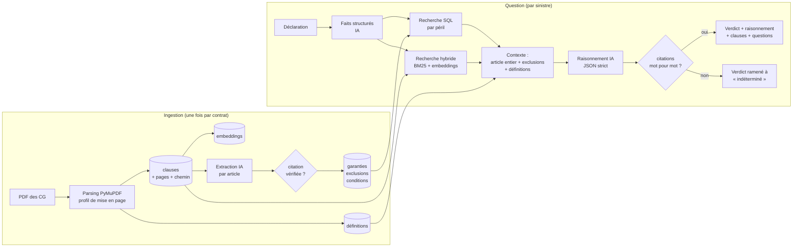

# Ce sinistre est-il couvert ?

Outil d'aide au gestionnaire sinistre : à partir des **conditions générales** d'un contrat multirisque
habitation et d'une **déclaration de sinistre**, il dit si le sinistre est couvert, explique pourquoi,
**cite les clauses exactes** (vérifiées mot pour mot), et dit ce qu'il faut demander à l'assuré quand
la réponse dépend d'un fait inconnu.

Réalisé pour le sujet 1 de l'exercice [recrutement IA du Groupe Foyer](https://lux-guide.github.io/recrutement-ia/).
Données uniquement publiques (voir [data/sources.md](data/sources.md)).

- **Démo** : https://sinistre-conditions-generales-tv8vmtq3bfzriaaq7nerpf.streamlit.app/ (application gratuite : si elle est en veille, cliquer sur « Yes, get this app back up » et patienter ~1 min)
- **Choix techniques détaillés** : [DECISIONS.md](DECISIONS.md)

---

## Le problème

Un gestionnaire sinistre reçoit une déclaration en langage courant et doit trancher à partir d'un
contrat de 25 à 70 pages : quelle garantie peut jouer, sous quelles conditions, et quelle exclusion
peut l'écarter. Les deux cas de l'énoncé illustrent bien la difficulté :

> « Je me fais voler mon vélo dans le local commun de l'immeuble, qui n'était pas fermé à clé. Suis-je couvert ? »

La garantie vol existe, mais la réponse dépend de **là où** le vol a eu lieu (locaux assurés ou parties
communes), de **comment** (effraction ou non), et de la **définition** des locaux. La clause décisive
est une exclusion, pas la garantie.

> « Un assuré laisse une bougie sur la table de son jardin pendant ses vacances. Avec la chaleur, la bougie fond et abîme la table. Est-ce couvert ? »

Le réflexe « incendie » est faux : la garantie incendie suppose des flammes, et la plupart des contrats
excluent explicitement les dommages dus à la seule action de la chaleur. La table est par ailleurs du
mobilier de plein air, souvent exclu.

Dans les deux cas, la bonne réponse se trouve en croisant **garantie + définition + exclusion**, parfois
à 10 pages d'écart. Et le gestionnaire doit pouvoir vérifier la réponse en un coup d'œil.

## Pourquoi pas un simple chatbot sur le PDF

Donner le PDF brut à un chatbot fonctionne en démonstration sur un contrat, puis casse :

| Problème | Ce qui se passe | Ce que fait l'outil |
|---|---|---|
| **Longueur** | 70 pages = 75 000 tokens par question ; les modèles lisent moins bien le milieu d'un long contexte | Le contrat est lu une fois à l'ingestion ; une question ne mobilise que ~15 clauses ciblées |
| **Exclusions manquées** | La garantie « ressemble » davantage à la question que l'exclusion qui l'écarte | L'article est toujours fourni en entier (garantie + exclusions + prévention), plus les exclusions générales |
| **Définitions** | « Incendie », « dépendances », « locaux assurés » sont définis ailleurs dans le document | Le lexique est indexé à part et injecté dès qu'un terme défini apparaît |
| **Citations invérifiables** | Le modèle peut paraphraser ou inventer un article | Chaque citation est recherchée mot pour mot dans la clause ; un échec rend le verdict « indéterminé » |
| **Passage à l'échelle** | Chaque question relit le contrat ; comparer 300 contrats = 300 lectures | Les garanties, exclusions et conditions deviennent des tables SQL interrogeables |

Constat concret (Altima) : pour le cas du vélo, la recherche hybride classe l'exclusion décisive
(Art. 4.7 §2, « locaux à usage commun ») **hors du top 6**. Un RAG classique répondrait « couvert »
en citant la garantie vol. La structure du contrat (garantie et exclusions dans le même article)
corrige ce que la recherche seule rate.

## Architecture



**Parsing** (`parse.py`). PyMuPDF donne pour chaque ligne la police, la taille, le gras et la position.
Un *profil* par modèle de contrat (5 à 10 lignes de regex dans `data/contracts.yaml`) décrit les niveaux
de titres : Titre > Chapitre > Article > sous-article. Chaque article est découpé sur ses intertitres
(« Ce que nous garantissons », « Ce que nous ne garantissons pas », « Prévention ») : chaque exclusion
devient une clause citable avec un identifiant stable (`Art. 4.7 §2`) et sa page. Sont traités : les
deux colonnes (lecture par bandes), les en-têtes et pieds de page répétés, les titres sur deux lignes et
les puces en police Symbol. Le lexique est découpé en une clause par terme défini. Aucune IA à cette étape :
le texte stocké est celui du PDF, ce qui permet ensuite la vérification mot pour mot.

**Stockage** (`store.py`). Un fichier SQLite : `contracts`, `clauses` (avec chemin de section et
embedding), `definitions`, et les trois tables extraites. Versionné avec le code : l'application déployée
ne ré-ingère jamais.

**Extraction structurée** (`extract.py`). Une fois par contrat, article par article, un LLM remplit
`guarantees` (péril, portée, plafond, franchise, option), `exclusions` (liées à leur garantie ou
générales) et `conditions` (effraction requise, locaux fermés, inoccupation > N jours, prévention…).
Chaque ligne porte sa `clause_id` et une citation exacte, **vérifiée comme les réponses** ; une ligne non
vérifiable est marquée `rejete_citation` et ignorée. Validation Pydantic, taxonomie de périls commune,
idempotence par empreinte du PDF et version du prompt.

**Compréhension du sinistre** (`reason.py`). La déclaration devient des faits : périls possibles, lieu
(logement, dépendance privative, partie commune, jardin…), effraction, fermeture à clé, absence,
flammes. Ce qui n'est pas dit vaut `null`.

**Recherche ciblée** (`pipeline.py`, `retrieve.py`). Requête SQL sur les tables extraites pour les périls
du sinistre (garanties, exclusions propres et générales, conditions), plus une recherche hybride BM25 +
embeddings fusionnée par RRF, **restreinte au contrat choisi**. Le contexte est assemblé par priorité :
articles de garantie complets, exclusions et conditions, définitions des termes présents, puis le reste
de la recherche, dans un budget de 18 000 caractères.

**Raisonnement** (`reason.py`). Le modèle suit une méthode imposée : garantie → conditions → exclusions →
conclusion, et répond en JSON strict : `verdict`, `raisonnement` (étapes courtes), `clauses_citées`
(`clause_id`, page, citation exacte), `informations_manquantes`, `confiance` et sa raison.

**Vérification** (`verify.py`). Chaque citation est recherchée dans la clause citée après normalisation
des seuls écarts dus au PDF (espaces, retours à la ligne, apostrophes, casse, puces). Une citation
introuvable, une clause inconnue ou l'absence de citation ramènent le verdict à « indéterminé ». La page
affichée vient de la base, pas du modèle.

**Interface** (`app/streamlit_app.py`). Badge de verdict, raisonnement, questions à poser à l'assuré,
clauses citées avec l'extrait surligné dans son contexte et la page, indicateur de vérification des
citations. Mode **comparaison** : le même sinistre sur tous les contrats côte à côte. Onglet **Base des
contrats** : les tables extraites, filtrables, avec la traçabilité des extractions.

## Passer à des centaines de contrats

- **Extraction structurée = la réponse au passage à l'échelle.** Le coût de lecture d'un contrat est payé
  une fois. Une question devient une requête SQL plus la lecture d'une quinzaine de clauses, quelle que
  soit la taille du contrat. Comparer un sinistre sur 300 contrats revient à 300 petites requêtes
  ciblées, pas à 300 lectures de 70 pages. Des questions transverses (« quels contrats excluent le vol
  dans les parties communes ? ») sont de simples `SELECT`.
- **Coût, ordre de grandeur.** Lecture complète par question : ~75 000 tokens. Avec l'outil : ~6 000 tokens
  par question + ~90 000 tokens une seule fois à l'extraction. Le point mort est atteint dès la deuxième
  question sur le même contrat.
- **Métadonnées par contrat** : assureur, produit, édition, URL source, empreinte du PDF, nombre de pages.
  En production : formule, date d'effet, et lien vers les conditions particulières du client.
- **Ingestion incrémentale** : ajouter un contrat = une entrée dans le registre et `sinistre-build`.
  Les contrats inchangés (même empreinte) sont sautés.
- **Versionnement des contrats** : une nouvelle édition change l'empreinte et ne remplace que ce contrat ;
  en production, on garderait toutes les éditions (`contract_id` + `edition`) car un sinistre se juge
  sur l'édition en vigueur à la date du sinistre.
- **Modèles de mise en page** : des centaines de contrats proviennent de quelques dizaines de modèles
  (assureur × édition). Un profil de parsing se réutilise sur tous les contrats du même modèle.
- **Revue humaine des lignes extraites** : chaque ligne a un `review_status` (`a_valider`, `valide`,
  `rejete_citation`) et sa citation. Un juriste ou un souscripteur valide la fiche d'un contrat une fois ;
  les indicateurs par colonne (taux de citations vérifiées, taux de remplissage) disent où regarder d'abord.
- **Infrastructure** : le schéma SQLite se transpose à Postgres + pgvector sans changement de modèle de
  données.

## Gérer l'incertitude

L'outil préfère un « indéterminé » justifié à un verdict fragile, sur trois mécanismes :

1. **Verdict « indéterminé » prévu par la méthode** : si la réponse dépend d'un fait inconnu (y a-t-il eu
   effraction ?), d'une option (Pack Jardin, formule) ou des conditions particulières, le modèle doit le
   dire plutôt que trancher.
2. **Vérification des citations** : une seule citation introuvable mot pour mot et le verdict devient
   « indéterminé », avec la raison affichée et le verdict que le modèle proposait.
3. **Questions à poser à l'assuré** : les faits manquants deviennent des questions concrètes
   (« La porte du local a-t-elle été forcée ? », « Le Pack Jardin est-il souscrit ? »).

## Résultats de l'évaluation

`eval/cases.yaml` : 16 cas, dont les deux de l'énoncé sur les trois contrats, des cas clairement couverts,
clairement exclus et réellement ambigus (option non connue, formule, mesure de prévention non respectée).
Verdicts attendus établis à la lecture des clauses, référencées dans chaque cas.

<!-- RESULTS -->
### Résultats (v2, version actuelle)

Modèle : `qwen/qwen3.8-27b:free` · 16 cas · 0 en erreur

| Indicateur | Résultat |
|---|---|
| Verdict exact (verdict attendu) | 81 % (13/16) |
| Verdict acceptable (attendu ou prudent admis) | 100 % (16/16) |
| Citations vérifiées mot pour mot | 96 % (49/51) |
| Clause attendue citée et vérifiée | 94 % (15/16) |
| « Indéterminé » quand il est attendu | 100 % (2/2) |
| « Indéterminé » sur un cas clair (prudence excessive) | 23 % (3/13) |
| Erreurs affirmées (verdict faux, non « indéterminé ») | 0 % (0/16) |
| Verdicts rétrogradés par la vérification | 0 |

| Cas | Catégorie | Attendu | Obtenu | Citations OK | Clause attendue |
|---|---|---|---|---|---|
| `velo_local_commun_altima` | clair_exclu | non couvert | ✅ non couvert | 3/3 | ✅ |
| `velo_local_commun_macsf` | clair_exclu | non couvert / indéterminé | 🟡 indéterminé | 2/3 | ❌ |
| `velo_local_commun_matmut` | clair_exclu | non couvert | ✅ non couvert | 2/2 | ✅ |
| `bougie_jardin_altima` | clair_exclu | non couvert | ✅ non couvert | 4/4 | ✅ |
| `bougie_jardin_macsf` | clair_exclu | non couvert / indéterminé | 🟡 indéterminé | 4/4 | ✅ |
| `bougie_jardin_matmut` | clair_exclu | non couvert | ✅ non couvert | 4/4 | ✅ |
| `cambriolage_effraction_matmut` | clair_couvert | couvert / indéterminé | ✅ couvert | 4/4 | ✅ |
| `foudre_surtension_matmut` | clair_couvert | couvert | ✅ couvert | 3/3 | ✅ |
| `fuite_canalisation_altima` | clair_couvert | couvert | ✅ couvert | 4/4 | ✅ |
| `vitre_ballon_macsf` | clair_couvert | couvert | ✅ couvert | 2/2 | ✅ |
| `vitre_ballon_altima` | clair_couvert | couvert | ✅ couvert | 2/2 | ✅ |
| `fer_a_repasser_matmut` | clair_exclu | non couvert | ✅ non couvert | 3/3 | ✅ |
| `velo_cave_matmut` | clair_exclu | non couvert / indéterminé | 🟡 indéterminé | 4/4 | ✅ |
| `salon_jardin_vole_macsf` | ambigu | indéterminé / non couvert | ✅ indéterminé | 3/3 | ✅ |
| `surtension_lave_linge_altima` | ambigu | indéterminé / couvert | ✅ indéterminé | 2/3 | ✅ |
| `gel_absence_altima` | ambigu | couvert / indéterminé | ✅ couvert | 3/3 | ✅ |

✅ verdict attendu · 🟡 verdict prudent admis · ❌ verdict faux

### Avant / après : ce que la première évaluation a révélé

| Indicateur | v1 | v2 |
|---|---|---|
| Verdict exact | 47 % | 81 % |
| Verdict acceptable | 73 % | 100 % |
| Citations vérifiées mot pour mot | 72 % | 96 % |
| « Indéterminé » sur un cas clair | 67 % | 23 % |
| Erreurs affirmées | 0 % | 0 % |

La v1 ne produisait **aucune erreur affirmée** : quand elle se trompait, elle disait « indéterminé ».
Mais elle était trop prudente, et 28 % de ses citations étaient rejetées. L'analyse des rejets a montré
que la vérification faisait son travail : le modèle citait des clauses qu'il ne voyait que dans la fiche
structurée, en paraphrasant leur description. La cause réelle était l'assemblage du contexte. Sur MACSF
(~180 lignes de garanties), les articles de garantie secondaires épuisaient le budget avant les
exclusions décisives (Matmut Art. 16-4 était absent du contexte du cas vélo). Corrections en v2 :
contexte trié par pertinence, exclusions avant garanties secondaires, fiche limitée aux clauses fournies
en texte intégral, et règle « indéterminé » resserrée (une formule ou une franchise inconnue ne suffit
pas : « couvert », avec le point à vérifier dans les questions). Détail v1 : `eval/results_v1.md`.

**Honnêteté sur la mesure** : ces 16 cas ont servi à la fois à trouver ces défauts et à mesurer leur
correction. Les corrections sont générales (aucune ne vise un cas précis), mais un vrai jeu de test
indépendant, relu par des gestionnaires sinistre, est la prochaine étape. Modèle gratuit
(`qwen3.8-27b`) : un modèle plus fort améliorerait surtout les 3 cas restés prudents.
<!-- /RESULTS -->

Lancer : `python eval/run_eval.py`.

## Limites et ce que je ferais en production

- **Conditions particulières.** Elles priment sur les conditions générales (formule, options, plafonds,
  franchises, niveau de protection exigé). L'outil ne les connaît pas et le signale. En production :
  les ingérer par contrat client avec le même pipeline, et appliquer la règle « CP > CG » dans le contexte.
- **Humain dans la boucle.** L'outil prépare la décision, le gestionnaire la prend. Prochaine étape :
  boutons « d'accord / pas d'accord + clause manquante » sur chaque réponse.
- **Boucle de retour.** Les désaccords des gestionnaires alimentent `eval/cases.yaml` : l'évaluation
  grandit avec les vrais cas, et toute modification de prompt ou de modèle est rejouée dessus avant mise
  en production.
- **Suivi en production** : taux de citations rejetées, part d'« indéterminé », temps de réponse,
  désaccords par contrat. Une hausse des citations rejetées sur un contrat signale souvent un problème
  de parsing.
- **Contrats scannés** : OCR en amont (Docling ou Tesseract) ; le reste du pipeline est inchangé, mais la
  vérification mot pour mot doit tolérer les erreurs d'OCR, ou s'appuyer sur un texte relu.
- **Pièces du dossier** : photos, dépôt de plainte, factures. Les faits extraits de ces pièces
  (« plainte mentionnant une effraction ») remplaceraient les `null` et réduiraient les « indéterminé ».
- **Tableaux de garanties** (plafonds par bien) : aujourd'hui une clause par page ; à faire en
  « une ligne de tableau = un chunk avec ses en-têtes ».
- **Modèle** : la démo utilise un modèle gratuit. Pour un assureur, Mistral (hébergement UE) ou un
  modèle ouvert auto-hébergé (vLLM) est l'option souveraine : les déclarations contiennent des données
  personnelles. Le changement tient en trois variables d'environnement.

## Mon expérience terrain

Ce projet reprend des choix que j'ai déjà dû faire en production sur des produits d'IA dans la santé,
un domaine où, comme en assurance, une réponse non justifiée n'est pas acceptable.

### MedKit.ai : documentation médicale assistée par IA (en production)

Site : https://med-kit-ai.vercel.app

Deux modules, avec le même principe : l'IA prépare, le professionnel de santé valide au regard de la source.

- **Documents → données vérifiées.** Les documents médicaux (comptes rendus, courriers, formulaires)
  deviennent des données structurées ; le document source est affiché à côté des champs extraits pour
  que chaque valeur soit validée. Extraction par modèle de vision exécuté en local (LLaVA via Ollama).
- **Assistant vocal.** Une consultation enregistrée devient une note structurée au format SOAP :
  transcription locale (faster-whisper, modèle de reconnaissance vocale médicale MultiMed), détection de
  la langue, génération de la note par LLM avec un score de confiance par note.

Stack : React/Vite, Node/Express, FastAPI, SQLite, modèles locaux ; site et programme bêta (inscriptions,
contact) déployés sur Vercel. Dans le même cadre, un POC pour les
services de santé au travail (SPSTI) : score d'aide à la priorisation des visites de prévention, sur
données synthétiques, avec explicabilité SHAP et une analyse RGPD / AI Act avant tout déploiement réel.

**[À COMPLÉTER : utilisateurs ou bêta-testeurs, volume de documents traités, taux de correction
manuelle des champs, un incident ou un échec et ce qui a été changé ensuite.]**

Dans mon poste actuel, j'ai également conçu et mis en production un assistant d'IA médical fonctionnant
entièrement en local. Conformément à la règle de l'exercice, je ne le décris pas ici ; je peux en parler
en entretien, dans les limites de la confidentialité due à mon employeur.

### Ce que j'en ai retenu, et appliqué ici

- **Montrer la source à côté de la réponse.** Dans MedKit, une valeur extraite n'est utile que si
  l'utilisateur peut la vérifier en un coup d'œil sur le document. Ici, chaque citation est surlignée
  dans sa clause, avec la page.
- **Structurer avant de générer.** Une note SOAP ou une table de champs se contrôle ; un texte libre non. Ici, les
  contrats deviennent des tables et la réponse un JSON strict, validé.
- **Des garde-fous en code, pas seulement dans le prompt.** Ici, vérification mot pour mot des citations
  et rétrogradation automatique du verdict, plutôt qu'une consigne « cite tes sources » laissée au modèle.
- **La souveraineté des données comme contrainte de conception.** Dans la santé, les données de patients
  ne sortent pas ; ici, le fournisseur de LLM se change par configuration, ce qui permet Mistral ou un
  modèle auto-hébergé, adapté aux déclarations de sinistre qui contiennent des données personnelles.
- **Ne jamais afficher de chiffres non mesurés.** J'ai retiré du site MedKit des indicateurs et des
  témoignages qui n'étaient pas réels. Ici, l'évaluation publie aussi la première version, moins bonne,
  et dit sur quels cas elle a été mise au point.

## Lancer le projet

### En local

```bash
git clone <ce dépôt> && cd foyer-sinistre
python -m venv .venv && source .venv/bin/activate     # Windows : .venv\Scripts\activate
pip install -e ".[dev]"
cp .env.example .env                                    # puis renseigner LLM_API_KEY (et le fournisseur)

streamlit run src/sinistre/app/streamlit_app.py         # l'interface, sur la base déjà construite
pytest                                                  # tests unitaires
python eval/run_eval.py                                 # évaluation (rejouée depuis le cache)
sinistre-build                                          # reconstruire la base (idempotent)
```

Ajouter un contrat : déposer le PDF dans `data/raw/`, ajouter une entrée (et au besoin un profil) dans
`data/contracts.yaml`, lancer `sinistre-build`. `scripts/inspect_parse.py <contract_id>` affiche l'arbre
de clauses obtenu pour mettre au point un profil.

### Déploiement (Streamlit Community Cloud)

1. Pousser le dépôt sur GitHub (public). `data/contracts.db` et `data/cache/` sont versionnés : la démo
   n'a besoin d'aucune ingestion.
2. Sur https://share.streamlit.io : **Create app** → choisir le dépôt, la branche `main`, et le fichier
   principal `src/sinistre/app/streamlit_app.py`.
3. **Advanced settings** → Python 3.11, et dans **Secrets** :
   ```toml
   LLM_PROVIDER = "openai_compatible"
   LLM_BASE_URL = "https://api.mistral.ai/v1"
   LLM_MODEL = "mistral-small-latest"
   LLM_API_KEY = "..."
   ```
4. **Deploy**. Les dépendances sont installées depuis `requirements.txt` (qui installe le paquet).
   Le modèle d'embeddings (220 Mo) est téléchargé au premier lancement.

Le cache est indexé par modèle : avec le même `LLM_MODEL` que celui qui a construit la base
(`qwen/qwen3.8-27b:free` ici), les deux exemples et les cas d'évaluation sont servis depuis le cache,
instantanément. Une nouvelle déclaration, ou un autre modèle, nécessite la clé d'API.
